<h1 align="center">InfantiWeb · Mi mundo emocional</h1>

<p align="center">
  <b>Una plataforma web para que niñas y niños de 6 a 10 años aprendan a reconocer, comprender, expresar y calmar sus emociones jugando, con su familia acompañando el progreso.</b>
</p>

<p align="center">
  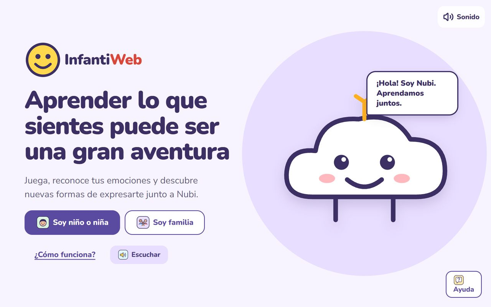
</p>

<p align="center">
  <a href="#qué-es-infantiweb">Qué es</a> ·
  <a href="#recorrido-por-la-app">Recorrido</a> ·
  <a href="#características">Características</a> ·
  <a href="#cómo-ejecutarlo">Cómo ejecutarlo</a> ·
  <a href="#usuarios-de-demostración">Usuarios de demostración</a> ·
  <a href="#tecnologías">Tecnologías</a>
</p>

---

## Qué es InfantiWeb

**El niño aprende y juega; la familia observa y acompaña.** InfantiWeb propone un camino de aventuras cortas (de 2 a 4 minutos) en el que el niño descubre las emociones en situaciones de su vida diaria: un cumpleaños, un juguete roto, un trueno en la noche. Nubi, una nube amigable, lo guía; cada intento cuenta y equivocarse nunca quita puntos.

La **accesibilidad es su diferencia**: todo se puede escuchar y todo queda escrito, la letra se puede agrandar, hay alto contraste, se puede usar con teclado y con lector de pantalla, y las animaciones se pueden apagar.

Es el **prototipo de alta fidelidad** (Proyecto Bimestral I) del curso **Usabilidad y Accesibilidad** de la **Escuela Politécnica Nacional**. Se diseñó a partir de pruebas reales: la evaluación de tres aplicaciones con los principios de Krug, el cuestionario SUS, un Focus Group con niños y familias y una evaluación heurística del prototipo anterior.

| En números | |
|---|---|
| Módulos de aprendizaje | 4 (Reconociendo emociones, Comprendiendo lo que siento, Aprendiendo a calmarme y Mis relaciones con otros) |
| Actividades y preguntas | 19 actividades, 55 preguntas, 7 tipos de actividad |
| Ilustraciones | 72 ilustraciones de cuento (una escena propia por pregunta) y 28 gráficos vectoriales |
| Historias de usuario | 12 de 12 cumplidas |
| Accesibilidad | 0 violaciones con axe-core (WCAG 2.2 AA) en las pantallas principales |
| Pruebas automatizadas | 31 pruebas aprobadas |

---

## Recorrido por la app

### Para niñas y niños

<table>
  <tr>
    <td width="50%">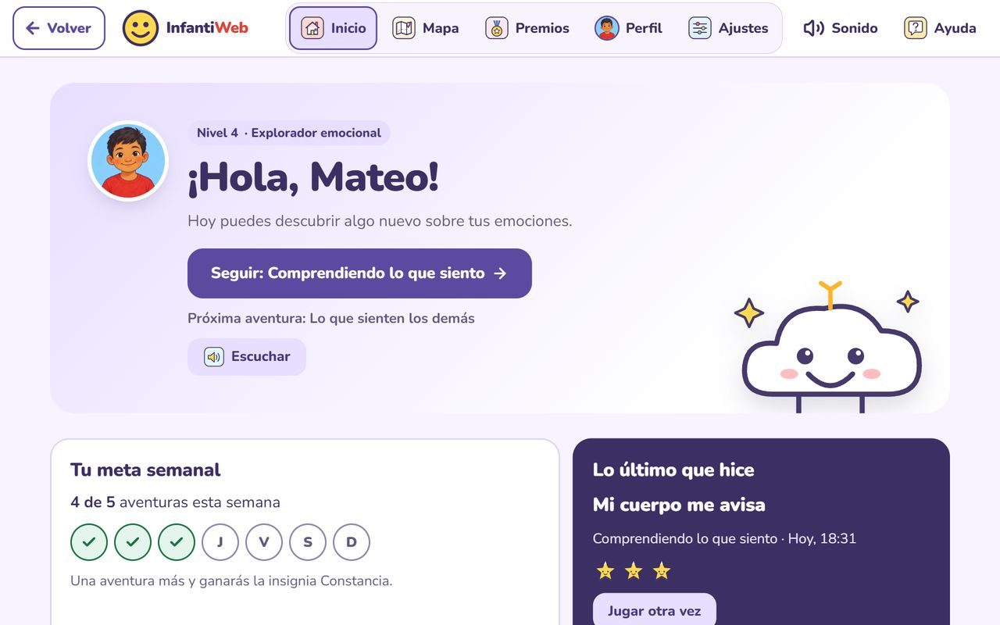</td>
    <td width="50%">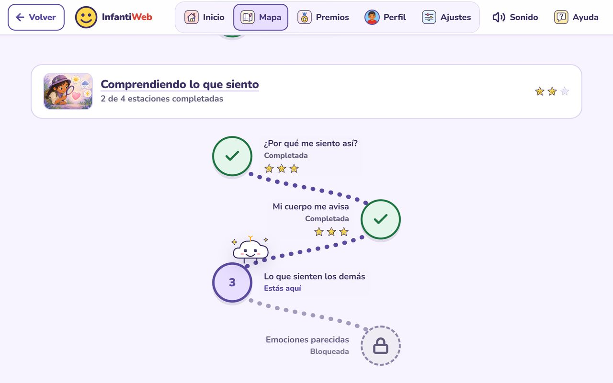</td>
  </tr>
  <tr>
    <td><b>Inicio.</b> Saluda por su nombre, muestra el nivel y lleva directo a la próxima aventura con «Seguir».</td>
    <td><b>Mapa.</b> Cada módulo es un camino de estaciones; Nubi espera en la actual y lo bloqueado tiene candado.</td>
  </tr>
  <tr>
    <td>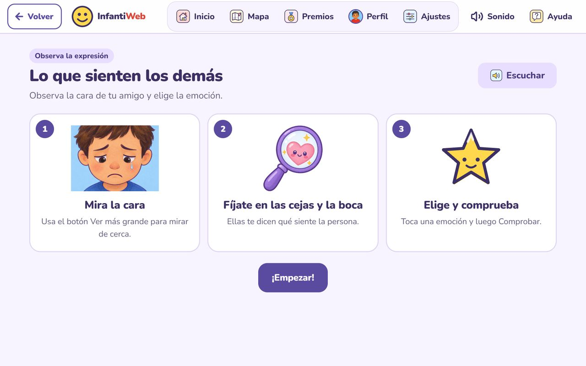</td>
    <td>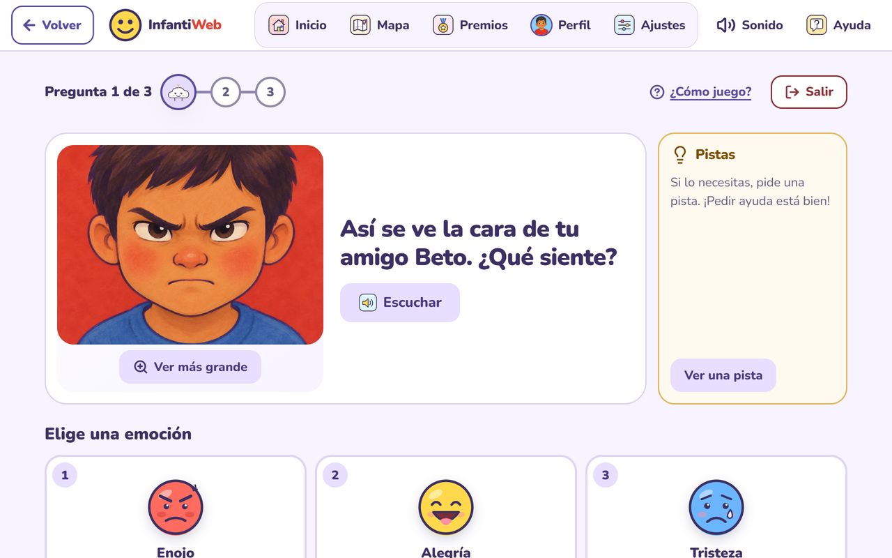</td>
  </tr>
  <tr>
    <td><b>Antes de jugar.</b> Un ejemplo de tres pasos con dibujos explica qué hacer.</td>
    <td><b>Una pregunta por pantalla.</b> Con imagen, botón «Escuchar», pistas al lado y atajos 1, 2 y 3.</td>
  </tr>
  <tr>
    <td>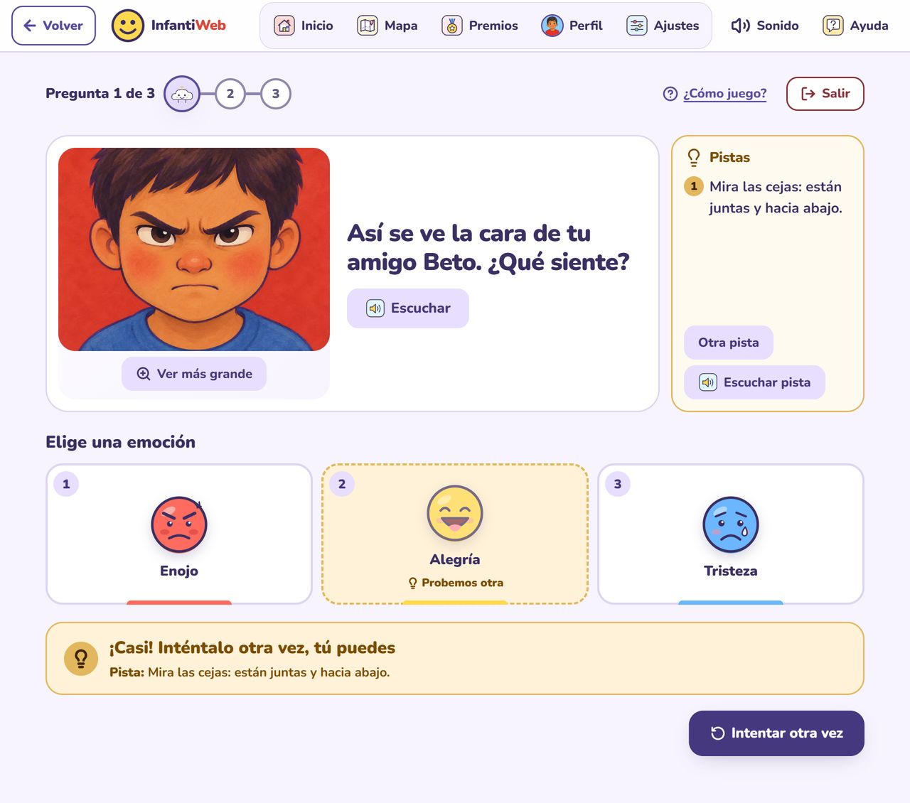</td>
    <td>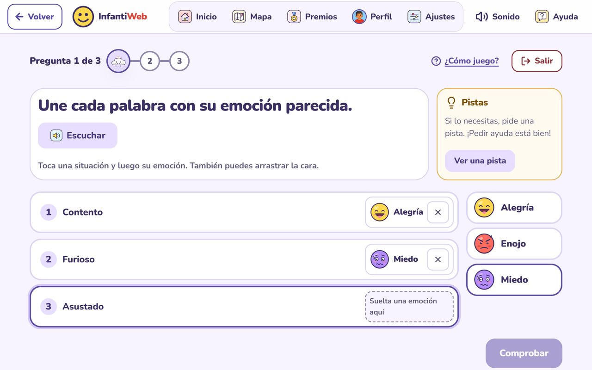</td>
  </tr>
  <tr>
    <td><b>Equivocarse está bien.</b> Una bombilla, una pista y otra oportunidad; nunca se pierden puntos.</td>
    <td><b>Siete tipos de actividad.</b> Aquí, «Une las emociones»: se toca o se arrastra.</td>
  </tr>
  <tr>
    <td>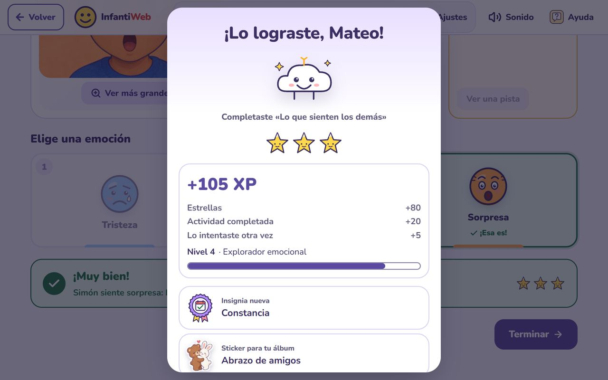</td>
    <td>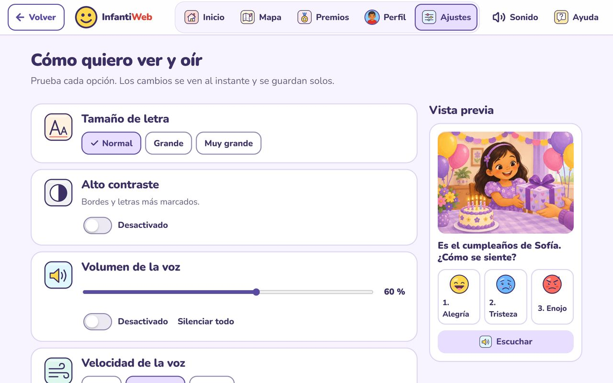</td>
  </tr>
  <tr>
    <td><b>Celebración.</b> Estrellas, puntos, nivel, la insignia ganada con su nombre y un sticker nuevo.</td>
    <td><b>Cómo quiero ver y oír.</b> Letra, contraste, volumen, velocidad de la voz y menos movimiento.</td>
  </tr>
</table>

<p align="center">
  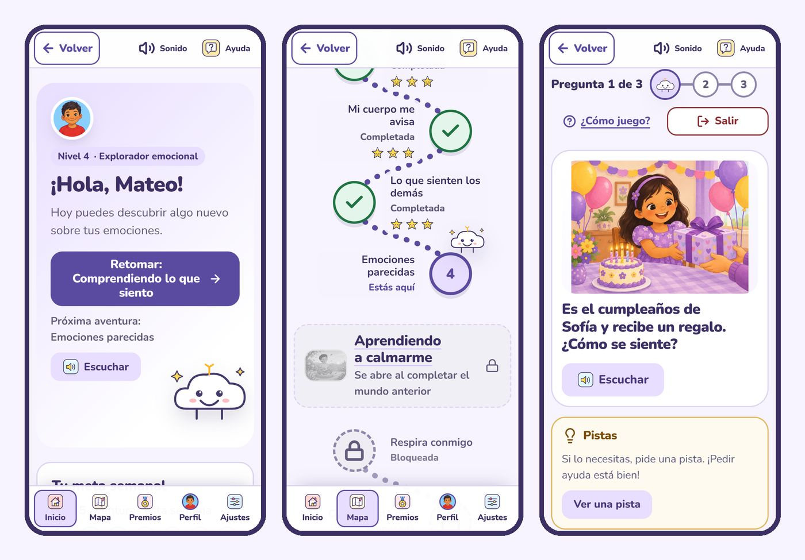
  <br>
  <sub>Pensado primero para el celular, que es lo que usan todos los niños del Focus Group.</sub>
</p>

### Para la familia

<table>
  <tr>
    <td width="50%">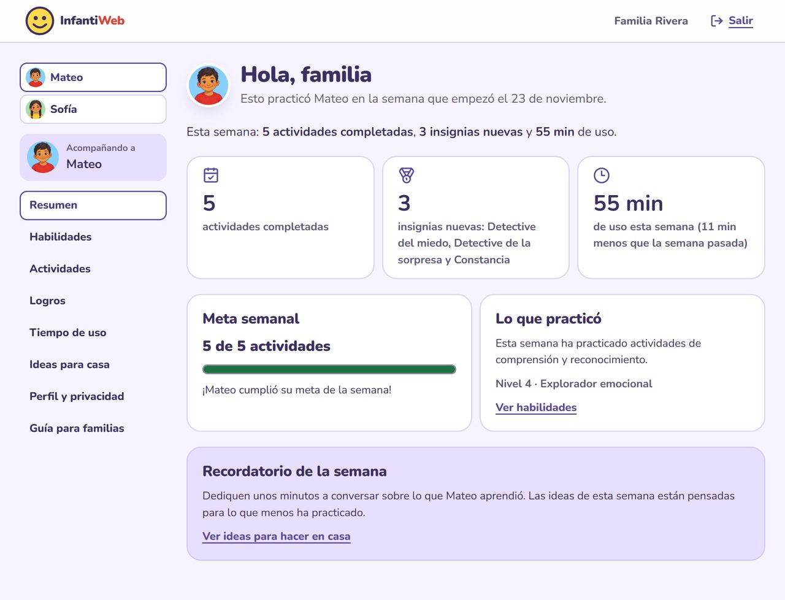</td>
    <td width="50%">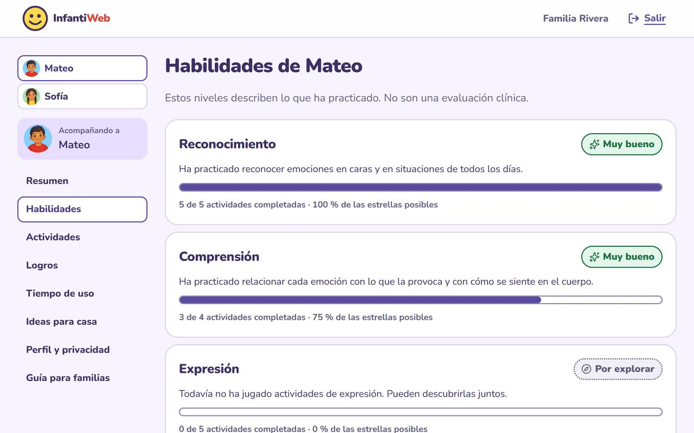</td>
  </tr>
  <tr>
    <td><b>Resumen semanal.</b> Qué practicó, insignias nuevas, tiempo de uso, meta y avisos de «Necesito ayuda».</td>
    <td><b>Habilidades.</b> Niveles en palabras (Muy bueno, Bueno, En progreso, Por explorar), nunca diagnósticos.</td>
  </tr>
</table>

<details>
<summary><b>Ver «Mis premios»: insignias, evolución de Nubi y álbum de stickers</b></summary>
<p align="center">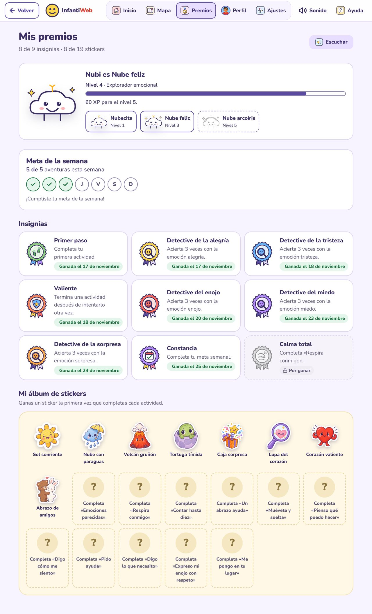</p>
</details>

---

## Características

**Sección del niño.** Bienvenida, «¿Cómo funciona?», acceso con clave escrita o con tres imágenes, recuperación de la clave con ayuda de un adulto, tutorial con Nubi, inicio, mapa, detalle de módulo, actividades, celebración, «Mis premios», perfil con avatar, ajustes de accesibilidad y ayuda con «Necesito ayuda».

**Siete tipos de actividad.**

| Actividad | Cómo se juega |
|---|---|
| Identifica la emoción | Mira una escena de la vida diaria y elige cómo se siente el personaje. |
| Observa la expresión | Mira un rostro de cerca (con lupa) y descubre la emoción por las cejas y la boca. |
| Escucha y responde | Escucha una historia, que también queda escrita, y responde. |
| Une las emociones | Une situaciones o palabras con su emoción, tocando o arrastrando. |
| ¿Qué harías? | Elige una estrategia; ninguna se califica como «mala», se explica su efecto. |
| Expreso lo que siento | Arma la frase «Siento… porque…» con dibujos y elige cuánto lo sientes. |
| Respira conmigo | Respiración guiada con un círculo que crece y baja, con pausa y sin evaluación. |

**Gamificación sin castigo.** De 3 a 1 estrellas por pregunta (nunca 0), puntos por estrella, actividad y módulo, premios por perseverar, 6 niveles con nombre, 9 insignias con su condición siempre visible, 19 stickers coleccionables, Nubi que evoluciona en tres etapas y una meta semanal de 5 actividades sin rachas que se pierden.

**Sección de familia.** Acceso con PIN (teclado numérico, PIN oculto, recuperación con pregunta de seguridad), resumen semanal, habilidades, historial de actividades, logros, tiempo de uso (gráfico y tabla), ideas para hacer en casa según lo menos practicado, perfil y privacidad (corregir o eliminar datos, cambiar la clave del niño y el PIN, contactar a soporte) y una guía para familias.

**Accesibilidad (WCAG 2.2 AA).** Botón «Escuchar» en cada instrucción, pregunta y pista con el texto siempre visible; lectura automática opcional; volumen y silencio siempre visibles; tres tamaños de letra; alto contraste; reducir movimiento; atajos de teclado; foco visible; lector de pantalla; botones de 48 px o más; funciona desde 360 px de ancho.

---

## Cómo ejecutarlo

### Requisitos

- **Node.js 22 LTS** (recomendado; funciona desde Node 20). Comprueba tu versión con `node -v`.
- **Git** para descargar el repositorio.
- **Chrome o Edge** para escuchar la voz del botón «Escuchar». La app funciona en otros navegadores, pero algunos (Firefox, ciertos Linux) no traen voces en español y no suenan; el texto siempre queda en pantalla.

No hace falta instalar SQLite: la base es un archivo que se crea solo.

### Pasos

1. Descarga el repositorio y entra a la carpeta (se llama `InfatiWeb`, sin la «n» de Infanti):

   ```powershell
   git clone https://github.com/JoseDA0721/InfatiWeb.git
   ```

   ```powershell
   cd InfatiWeb
   ```

2. Instala las dependencias de cliente y servidor (un solo comando para las dos carpetas):

   ```powershell
   npm install
   ```

3. Levanta la API y la app juntas:

   ```powershell
   npm run dev
   ```

4. Abre <http://localhost:5173>.

La API corre en el puerto 4000 y Vite le reenvía las peticiones `/api`. La primera vez se crea `server/data/infantiweb.db` con el contenido y los usuarios de demostración. Para detener todo, pulsa `Ctrl + C` en la terminal.

### Comandos útiles

| Comando | Qué hace |
|---|---|
| `npm run db:reset` | Borra la base y la vuelve a crear con la semilla (historial de Mateo relativo a la fecha de hoy). Ejecútalo también después de bajar cambios en el contenido. |
| `npm test` | Pruebas del servidor (reglas de gamificación y API) y del cliente (componentes). |
| `npm run typecheck` | Revisa los tipos de TypeScript en servidor y cliente. |
| `npm run build` | Compila cliente (`client/dist`) y servidor (`server/dist`). |
| `npm start` | Ejecuta el servidor compilado. Con `NODE_ENV=production` también entrega la app de React desde el mismo puerto. |

Configuración opcional: copia `.env.example` a `server/.env` (`API_PORT`, `JWT_SECRET`, `DB_PATH`). En producción `JWT_SECRET` es obligatorio.

---

## Usuarios de demostración

Datos ficticios creados por la semilla. No aparecen en la interfaz.

| Rol | Usuario | Clave | Notas |
|---|---|---|---|
| Niño | `Mateo` | `nubi123` · o imágenes: Nubi, Estrella, Cara feliz | Nivel 4, módulo 1 completo y 2 actividades del módulo 2; 4 de 5 en la meta semanal. |
| Niña | `Sofía` (o `sofia`) | `luna45` · o imágenes: Cara feliz, Familia, Respira | Cuenta nueva: verás el tutorial. |
| Familia | `rivera` | PIN `2468` | Vinculada a Mateo y Sofía. Pregunta de seguridad: primera mascota → `Canela`. |

El nombre no distingue mayúsculas ni tildes. Tras 5 intentos fallidos la cuenta hace una pausa de 5 minutos.

El historial de Mateo se arma según la fecha del día en que se crea la base. Si pasan días o semanas, su meta semanal y su tiempo de uso se verán vacíos; ejecuta `npm run db:reset` para regenerarlos con la fecha de hoy.

---

## Problemas comunes

| Síntoma | Solución |
|---|---|
| `npm install` falla al compilar `better-sqlite3` (menciona `node-gyp`, Python o Visual Studio) | Tu versión de Node no tiene binarios listos. Instala Node 22 LTS, borra la carpeta `node_modules` y vuelve a ejecutar `npm install`. |
| `EADDRINUSE` o «port is already in use» con el puerto 4000 | Otro programa usa ese puerto. Crea `server/.env` con `API_PORT=4001` (u otro libre) y vuelve a ejecutar `npm run dev`; la app también lee ese archivo. |
| Vite abre en 5174 en lugar de 5173 | El 5173 estaba ocupado; usa la dirección que muestra la terminal. |
| La página dice «No pudimos conectarnos» | La API no está corriendo: revisa la terminal de `npm run dev` y busca la línea `[api]` con el error. |
| Faltan imágenes en las preguntas o los datos quedaron mezclados | `npm run db:reset` (con `npm run dev` detenido) borra la base y la vuelve a crear con el contenido actual. |
| El botón «Escuchar» no suena | Revisa que el botón «Sonido» no esté en silencio y el volumen del equipo; usa Chrome o Edge. |
| No puedo entrar: «Tomemos una pausa» | Hubo 5 intentos fallidos; espera 5 minutos o ejecuta `npm run db:reset`. |

---

## Tecnologías

| Capa | Tecnología |
|---|---|
| Cliente | React 19, Vite, TypeScript, React Router, TanStack Query |
| Servidor | Node.js, Express 5, TypeScript, validación con Zod |
| Seguridad | Sesión JWT en cookie `httpOnly`, claves y PIN cifrados con bcrypt, límite de intentos |
| Base de datos | SQLite (better-sqlite3), migraciones SQL numeradas y semilla de demostración |
| Voz y sonido | Web Speech API (lectura en español) y Web Audio (sonidos breves) |
| Pruebas | Vitest, Supertest, Testing Library y axe-core |

## Estructura

```text
InfatiWeb/
├─ client/                 React + Vite
│  └─ src/
│     ├─ assets/           Vectores SVG (caras, insignias, pictogramas, Nubi)
│     │  └─ ilustraciones/ Escenas por pregunta, portadas, stickers, avatares y tutorial (WebP)
│     ├─ components/       Button, Modal, Stars, Nubi, SpeakButton, PinPad, PictureKey, WeeklyGoal…
│     ├─ features/         welcome, auth, tutorial, home, map, activities, rewards, profile,
│     │                    settings, help, family, preferences
│     ├─ layouts/          Layouts del niño y público
│     ├─ lib/              API, consultas, voz, sonidos, tipos
│     └─ styles/           tokens.css, base.css, ui.css, layout.css
├─ server/                 Express + SQLite
│  ├─ src/db/migrations/   001_init.sql
│  ├─ src/routes/          auth, child, family
│  ├─ src/services/        gamification (reglas puras), progress, attempts
│  ├─ src/seed/            contenido, semilla y reinicio
│  └─ test/                Vitest + Supertest
├─ imagenes/               Capturas usadas en este README
├─ PRODUCT.md              Contexto de producto
└─ DESIGN.md               Sistema visual
```

## Decisiones de diseño

- **Alcance:** niños y familias; sin panel docente ni administración (decisión confirmada del proyecto).
- **Contenido:** 19 actividades en 4 módulos (5, 4, 5 y 5) y 55 preguntas; el 64 % usa una escena ilustrada de la vida diaria (la historia de usuario HU-06 pide al menos 60 %).
- **Esquema de datos:** se respeta el modelo del documento del proyecto y se agregan los campos que pedían los requisitos: clave con imágenes, pregunta de seguridad, límite de intentos, retroalimentación por opción, frase construida y mensajes a soporte.
- **Desbloqueo:** cada actividad se abre al completar la anterior y cada módulo al completar el anterior.
- **Sesiones separadas** para niño y familia (dos cookies), para que un adulto pueda entrar con su PIN sin cerrar la sesión del niño.
- **Módulo 4:** se usa el nombre del prototipo, «Mis relaciones con otros», con la habilidad Expresión (pendiente de confirmar con la docente).
- **Cambios respecto al Figma:** íconos dibujados en lugar de emojis, barra inferior en celular, mapa con camino serpenteante, ilustraciones propias por pregunta y modo enfocado dentro de las actividades.

Más detalle en [PRODUCT.md](PRODUCT.md) (producto y usuarios), [DESIGN.md](DESIGN.md) (sistema visual) y [client/src/assets/ilustraciones/README.md](client/src/assets/ilustraciones/README.md) (origen de las ilustraciones).

---

<p align="center">
  Proyecto del curso <b>Usabilidad y Accesibilidad</b> · Escuela Politécnica Nacional · 2026<br>
  Licencia <a href="LICENSE">MIT</a>
</p>
